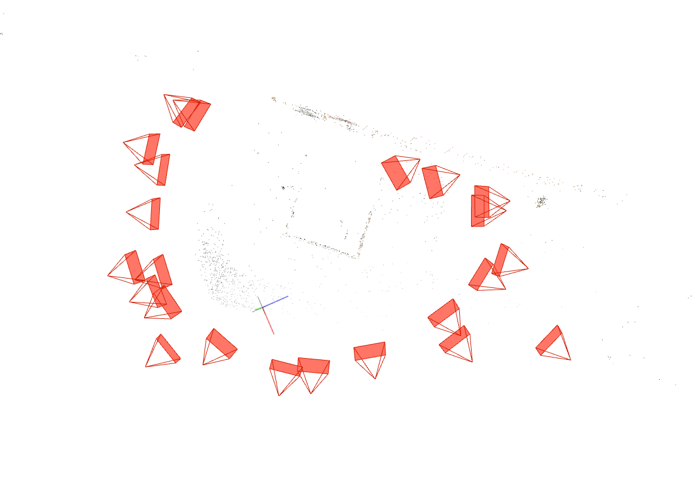
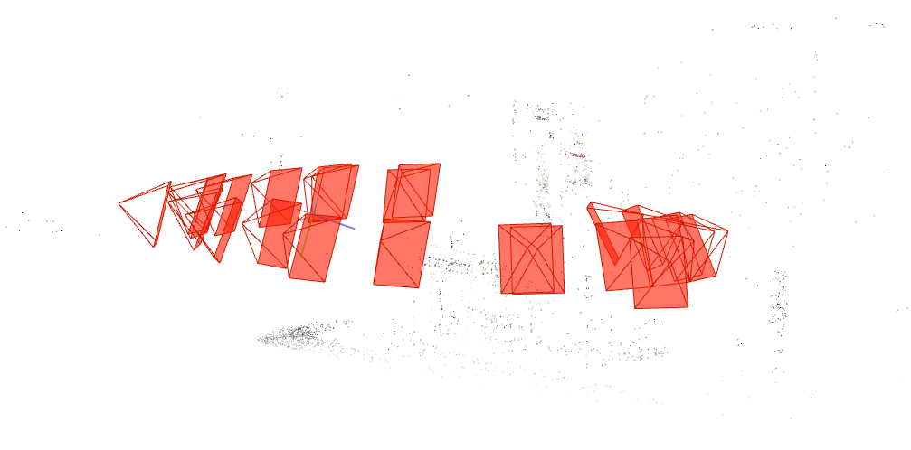
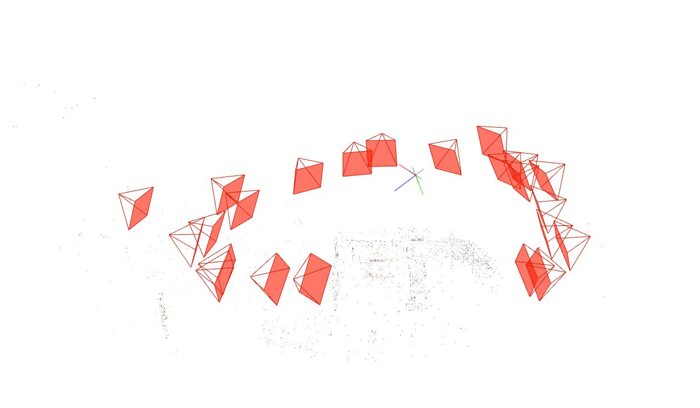
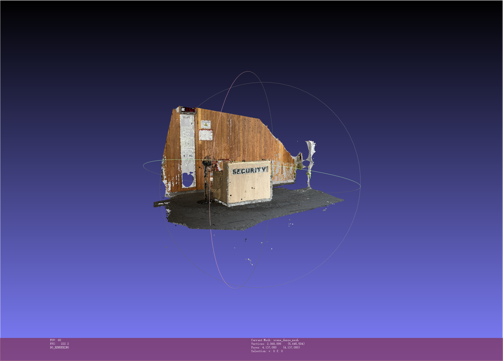

# Photo-to-3D Reconstruction with COLMAP + OpenMVS

This project reconstructs a textured 3D model from a set of multi-view smartphone photos using a classic **Structure-from-Motion (SfM)** + **Multi-View Stereo (MVS)** photogrammetry pipeline.

- **SfM (COLMAP)** estimates each image's camera intrinsics/extrinsics and a sparse 3D point cloud.
- **MVS (OpenMVS)** densifies the sparse cloud into a dense point cloud, reconstructs a mesh, and (optionally) textures it.

The whole pipeline runs inside **WSL2 (Ubuntu 26.04)** using official prebuilt binaries.

---

## Repository layout

```text
21-CV-Project/
├── data/                 # Input photos (24 HEIC images from a smartphone)
├── work/                 # Pipeline working directory (sparse/dense models, logs)
│   ├── images/           # Renamed/undistorted images (regenerated, git-ignored)
│   ├── db.db             # COLMAP feature database (git-ignored)
│   ├── sparse/           # COLMAP sparse reconstruction
│   ├── *.dmap            # OpenMVS depth maps (git-ignored, large)
│   ├── scene*.mvs        # OpenMVS scene files
│   └── scene*.ply        # Dense point cloud / mesh
├── output/               # Curated results + screenshots (committed)
│   ├── sparse_model/     # COLMAP sparse model + camera-position views
│   ├── densified/        # Dense point cloud + view
│   └── densified_mesh/   # Reconstructed mesh + view
├── colmap/  openMVS/  vcglib/  tools/   # Third-party source/binaries (git-ignored)
├── .gitignore
└── README.md
```

---

## Environment & prerequisites

- Windows 11 + WSL2, Ubuntu 26.04 LTS
- **COLMAP 3.12.6** (official Ubuntu package)
- **OpenMVS v2.4.0** (official Ubuntu x64 binary)
- `libheif` tooling for HEIC → JPG conversion

Install the binaries once:

```bash
# COLMAP
sudo apt update && sudo apt install -y colmap libheif-examples libheif-plugin-libde265

# OpenMVS (official Linux binary)
mkdir -p tools/openmvs && cd tools/openmvs
curl -L -o omvs.zip https://github.com/cdcseacave/openMVS/releases/download/v2.4.0/OpenMVS_Ubuntu_x64.zip
python3 -m zipfile -e omvs.zip .
chmod +x DensifyPointCloud InterfaceCOLMAP ReconstructMesh RefineMesh TextureMesh
export PATH="$(pwd):$PATH"
```

Note: on Ubuntu the `colmap` package needs the `libposelib` runtime as well:

```bash
sudo apt install -y libposelib
```

---

## Experiment setup

1. Capture ~24 multi-view photos of a static scene with the same phone, fixed zoom, and 60-80% overlap between consecutive shots.
2. Convert the photos (HEIC) to JPG and place them in `work/images/`:

```bash
cd /mnt/d/Repo/21-CV-Project
mkdir -p work/images
for f in data/*.HEIC; do
  heif-convert "$f" "work/images/$(basename "${f%.HEIC}").jpg"
done
```

---

## Experiment steps

All commands run from `work/` inside WSL.

### Stage 1 - Sparse reconstruction (COLMAP)

```bash
cd /mnt/d/Repo/21-CV-Project/work

# 1. Extract SIFT features (single shared camera)
colmap feature_extractor \
  --database_path db.db --image_path images \
  --ImageReader.single_camera 1 --SiftExtraction.use_gpu 1

# 2. Match features exhaustively
colmap exhaustive_matcher --database_path db.db --SiftMatching.use_gpu 1

# 3. Incremental SfM
colmap mapper --database_path db.db --image_path images --output_path sparse

# 4. Inspect statistics
colmap model_analyzer --path sparse/0
```

### Stage 2 - Dense reconstruction & meshing (OpenMVS)

```bash
# 5. Export the COLMAP model to OpenMVS interface format
InterfaceCOLMAP -i sparse/0 -o scene.mvs --image-folder images

# 6. Dense point cloud (depth maps + fusion)
DensifyPointCloud scene.mvs

# 7. Mesh reconstruction (force native MVS archive output)
ReconstructMesh scene_dense.mvs --archive-type 1

# 8. Optional refinement and texturing (memory-intensive, see Notes)
RefineMesh scene_dense_mesh.mvs
TextureMesh scene_dense_mesh_refine.mvs
```

---

## Results

### Stage 1 - Sparse reconstruction

COLMAP registered **23 / 24** images with a single shared camera:

| Metric | Value |
|---|---|
| Registered images | 23 / 24 |
| Sparse 3D points | 4,809 |
| Mean track length | 3.42 |
| Mean observations per image | 715.0 |
| Mean reprojection error | 1.227 px |

The recovered camera poses and sparse structure (three views):





### Stage 2 - Dense point cloud

`DensifyPointCloud` fused the per-view depth maps into a dense cloud of **3,576,606 points**:


### Stage 3 - Mesh

`ReconstructMesh` produced a surface mesh of **2,068,898 vertices / 4,137,080 faces**:



---

## Intermediate process (sparse → dense → mesh)

| Stage | Artifact | Screenshot |
|---|---|---|
| 1. SfM (camera poses + sparse points) | `output/sparse_model/` | `camera_position*.png` |
| 2. MVS dense cloud | `output/densified/scene_dense.ply` | `densified_demo.png` |
| 3. Surface mesh | `output/densified_mesh/scene_dense_mesh.ply` | `demo_mesh.png` |

---

## Human-in-the-loop checkpoints

- **After `mapper`**: check registration rate (should be close to 100%), camera trajectory sanity, and reprojection error (< 2 px). Delete blurry/duplicate photos and re-run if needed.
- **After `DensifyPointCloud`**: check for holes caused by low overlap, reflections, or textureless regions.
- **After `ReconstructMesh`**: remove floating components, close holes, and decimate if the mesh is over-dense.
- **After `TextureMesh`**: check texture sharpness, seams, and alignment.

---

## Notes & troubleshooting

- **HEIC input**: COLMAP cannot read HEIC; convert to JPG first. iPhone HEIC keeps the EXIF focal length, which COLMAP uses as an intrinsic prior.
- **Missing `libPoseLib.so`**: `sudo apt install -y libposelib`.
- **`heif-convert` decode error**: install `libheif-plugin-libde265`.
- **No `.mvs` after `ReconstructMesh`**: OpenMVS skips saving `.mvs` when the input is in interface format; run `ReconstructMesh scene_dense.mvs --archive-type 1`.
- **RefineMesh / TextureMesh run out of memory** (default WSL ~8 GB): decimate the mesh (`--target-face-num 500000`), raise WSL memory via `.wslconfig`, or lower `TextureMesh --texture-size`.

---

## Status

- [x] Sparse reconstruction (COLMAP)
- [x] Dense point cloud (OpenMVS)
- [x] Mesh reconstruction (OpenMVS)
- [ ] Mesh refinement (RefineMesh) - pending memory tuning
- [ ] Texturing (TextureMesh) - pending memory tuning

---

## Technical points

The pipeline relies on the following computer-vision techniques, mapped to the pipeline stage where each one is used and to the AI6121 lecture where it is introduced.

### Pipeline stage → technique

| Stage | Techniques used |
|---|---|
| HEIC → JPG | Image format conversion (preserves EXIF focal length) |
| Feature extraction | SIFT keypoint detection and 128-dimensional descriptor (Lecture 05) |
| Feature matching | Exhaustive descriptor matching with GPU acceleration (Lectures 05, 10) |
| Geometric verification | RANSAC, fundamental/essential matrix estimation, homography fitting (Lecture 10) |
| Camera modeling | Pinhole projection, intrinsic matrix `K` (focal length, principal point, radial distortion), shared single camera, EXIF focal prior (Lecture 08) |
| Pose & structure recovery | Incremental SfM, absolute pose estimation (P3P/PnP), two-view triangulation (Lectures 10, 11) |
| Global refinement | Bundle adjustment minimizing the reprojection error over cameras and 3D points (Lecture 11) |
| Dense reconstruction | Multi-view stereo depth-map estimation (PatchMatch) and depth-map fusion (Lecture 11) |
| Surface reconstruction | Delaunay tetrahedralization + graph-cut (OpenMVS `ReconstructMesh`) |
| Mesh post-processing | Decimation, spike/spurious-face removal, hole filling |
| Texturing | View selection, UV-atlas generation, color projection from source photos |

### Key mathematical concepts

- **Pinhole projection**: `x = f X / Z`, `y = f Y / Z`; homogeneous form `x = K[R | t] X` with the 3×4 projection matrix (Lecture 08).
- **Rigid transform**: world-to-camera `X_cam = R X_world + T` (rotation + translation).
- **Epipolar geometry**: epipolar constraint `p^T F p' = 0`; essential matrix `E = [T]_× R`; fundamental matrix `F = K^{-T} E K'^{-1}` (Lecture 10).
- **Triangulation / disparity**: for parallel stereo, `d = x_l - x_r = fT / Z` and `Z = fT / d` (Lecture 10).
- **Robust estimation**: RANSAC for outlier-rejected model fitting (Lecture 10).
- **Bundle adjustment**: `min sum_{i,j} || x_ij - proj(M_i, X_j) ||^2` (Lecture 11).
- **Multi-view stereo**: depth-map estimation and fusion into a dense point cloud (Lecture 11).

